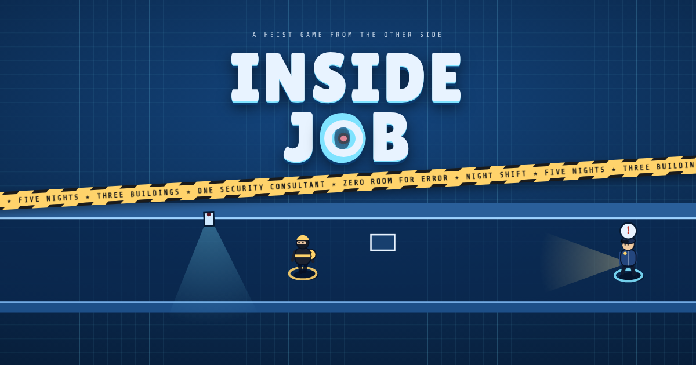

# Inside Job

A heist game from the other side. You're the security consultant: place cameras, lasers, plates, lights, guards, doors and fog cannons, and watch the crews pathfind around what you can see. Five nights, six buildings to unlock, Blueprint and Sketchbook styles.

## Play on a phone, full screen

1. Turn on GitHub Pages for this repo: **Settings → Pages → Build and deployment → Source: Deploy from a branch → Branch: `main`, folder `/ (root)` → Save**.
2. After a minute the game is live at `https://kyleh686.github.io/InsideJob/`.
3. **iPhone:** open that link in Safari, tap **Share → Add to Home Screen**. Launch it from the home-screen icon and it runs full screen with no browser bars.
4. **Android:** open the link in Chrome, tap **⋮ → Add to Home screen / Install app**, or just tap the ⛶ button in the game.

The game works offline after the first visit.

## Files

- `index.html` is the whole game: code, sounds and voices in one file.
- `manifest.webmanifest`, `sw.js` and the icons make it installable to the home screen.
- `src/` holds the source (`src.html`) and the build scripts. `build.py` injects the packed sounds (`sfx.json`, `vo.json`, built by `pack.py` and `gen.py`) into `src.html`.
- To build: `cd src && python3 build.py`. It writes `web/index.html` (copy to the repo root as `index.html`) and `ios/` (the app's `game.html`, `index.html`, `version.json`). `three.min.js` (three.js r160) and the packed sounds in `src/snd/` are committed so the build needs nothing else.

Sound effects are Kenney CC0. Control's voice is Kokoro `bf_lily` (Apache 2.0, commercial use allowed; made by `src/gen2.py`). The guard voice still uses the piper `en_US-ryan-high` model, which is CC BY-NC-SA, so swap it out before any commercial release. The 3D characters are from the KayKit Adventurers pack by Kay Lousberg (CC0); the trimmed models are in `src/kk/`. An Xcode project for a native iOS app is in `app/` (see `app/README.md`).
